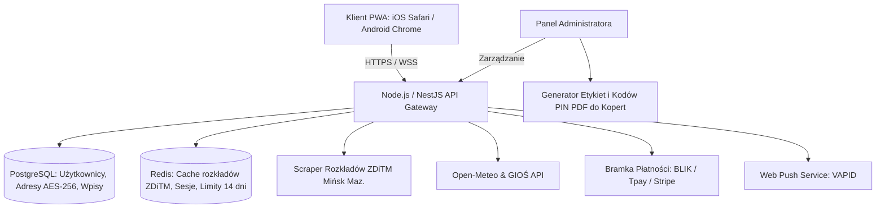

# DOKUMENTACJA PRODUKTOWA: mójMińsk.app (mójMińsk)

> **Status:** Wersja 1.1-ZATWIERDZONA (Po rundzie 30 decyzji produktowych)  
> **Typ aplikacji:** Progressive Web App (PWA Mobile-first) -> z planowanym przejściem do Google Play & App Store po osiągnięciu 500 mieszkańców  
> **Lokalizacja docelowa:** Mińsk Mazowiecki  
> **Cel KPI na pierwsze 3 miesiące:** 500 zweryfikowanych mieszkańców oraz stały przychód min. 3 000 zł netto / miesiąc  
> **Data aktualizacji:** Październik 2026  

---

## 1. Wstęp, Misja i Zasady Działania

### 1.1. Wizja Projektu
**mójMińsk.app** to hiperlokalna platforma społecznościowo-usługowa stworzona wyłącznie dla mieszkańców Mińska Mazowieckiego. Rozwiązuje problem dezinformacji, spamu, anonimowego hejtu i trolli w lokalnych grupach (np. na Facebooku), wprowadzając **fizyczną weryfikację adresu zamieszkania** oraz publiczną tożsamość sąsiedzką opartą na regule:  
> **„[Imię] z ulicy [Nazwa Ulicy]”** (np. *Wojtek ze Spacerowej*).

Dla innych użytkowników widoczne jest wyłącznie imię oraz nazwa ulicy. Pełne dane adresowe (numer domu, lokalu oraz nazwisko dla doręczyciela pocztowego) są **szyfrowane w bazie danych i dostępne wyłącznie dla Administratora** na potrzeby wysyłki listu weryfikacyjnego.

### 1.2. Model Dostępu Tymczasowego (Decyzja #1)
- Użytkownik po rejestracji (podanie imienia, wybór ulicy oraz pełnego adresu do korespondencji) otrzymuje **dostęp tymczasowy na 14 dni**.
- W okresie 14 dni użytkownik może w pełni testować aplikację, przeglądać treści i integrować się ze społecznością.
- Po 14 dniach wymagane jest wprowadzenie 6-cyfrowego kodu PIN z listu doręczonego do skrzynki pocztowej. Brak wpisania kodu powoduje zablokowanie możliwości tworzenia nowych treści do czasu aktywacji.

---

## 2. Architektura Finansowa i Model Biznesowy

Projekt został zaprojektowany w myśl zasady *„Małą łyżką dłużej się najesz”*, generując dodatni cashflow od pierwszego dnia i skalując się wraz ze wzrostem liczby mieszkańców.

```mermaid
flowchart TD
    subgraph Filar 1: B2B & Pakiety Partnerskie
        A1["Kupony powitalne w liście: 5 x 500 zł = 2 500 zł na start (w tym Motylek)"]
        A2["Strefa Przejazdu: Wyłączność Nova Taxi 500-1000 zł/mc"]
        A3["Strefa mGrocery: Wyłączność Motylek Market 1000-1500 zł/mc + prowizja 5-8%"]
        A4["Strefa Partnera (np. Jubiler): Pakiet łączony 400-800 zł/mc"]
        A5["Ogłoszenia o pracę dla firm: 10 zł / ogłoszenie (One-Click BLIK)"]
        A6["Strefa Gastronomii: Prowizja 8-12% od restauracji"]
        A7["Komercyjne ankiety badawcze i profilowane mailingi sponsorskie"]
    end

    subgraph Filar 2: Ruch Viralowy i Społeczność
        B1["Bitwy ankietowe (np. Najlepsza pizza w Mińsku)"]
        B2["Sąsiedzki carpooling (Mińsk <-> Warszawa oraz powiat)"]
        B3["Strefa Rozmów (X/Twitter dla Mińska z hasztagami ulic)"]
    end

    subgraph Filar 3: Crowdfunding i Wsparcie
        C1["Szybkie dotacje BLIK ('Wspieraj lokalne, niezależne medium')"]
    end

    Filar 1 --> Portfel["Zrównoważony Zysk: Min. 4000 - 5500 zł/mc"]
    Filar 2 --> Portfel
    Filar 3 --> Portfel
```

### 2.1. Zestawienie Strumieni Przychodowych

| Źródło Przychodu | Model Rozliczenia | Stawka Początkowa | Potencjał Skalowania |
| :--- | :--- | :--- | :--- |
| **Kupony w Listach Powitalnych** | Płatność jednorazowa od 5 partnerów na start | **2 500 zł** (5 x 500 zł, w tym Motylek Market) | Podniesienie stawki po osiągnięciu pierwszych 500 zweryfikowanych mieszkańców |
| **Wyłączność mGrocery (Motylek Market)** | Abonament miesięczny + prowizja koszykowa | **1 000 – 1 500 zł / mc** + 5–8% prowizji | Skalowanie wraz z obrotem e-grocery w Mińsku |
| **Sponsoring Strefy Przejazdu (Nova Taxi)** | Abonament miesięczny za wyłączność branżową | **500 – 1 000 zł / mc** | Możliwość rozszerzenia o dodatkowe formaty ekspozycji |
| **Płatne Ogłoszenia o Pracę** | Opłata za publikację na 14 dni | **10 zł brutto** (BLIK One-Click) | Pakiety dla agencji i większych pracodawców |
| **Strefa Kuchni (Restauracje)** | Prowizja od wartości zamówienia (GMV) | **8% – 12%** | Konkurencyjna alternatywa dla 25–35% w Glovo/Pyszne |
| **Strefa Partnera (np. Jubiler)** | Pakiet łączony (menu + baner + kod rabatowy) | **400 – 800 zł / mc** | Rotacja partnerów co miesiąc lub kwartał |
| **Badania Rynkowe & Mailingi** | Opłata za przygotowanie ankiety i raportu | **300 – 600 zł / badanie** | Profilowanie po preferencjach zakupowych i ulicach |
| **Dotacje od Mieszkańców** | Dobrowolny szybki BLIK | Dowolna (5, 10, 20 zł) | Budowanie więzi i wsparcie serwerów |

### 2.2. Rozliczenia Księgowe i Prawne (Decyzja #6)
- Wszystkie usługi B2B rozliczane są za pośrednictwem **Faktury VAT** (zarejestrowana działalność gospodarcza / spółka).
- Płatności mikrotransakcyjne (10 zł za ogłoszenie pracy) są w pełni zautomatyzowane z bramką płatności (Tpay / Przelewy24 / Stripe) generującą natychmiastowe potwierdzenie lub e-fakturę.

---

## 3. Logistyka Weryfikacji Pocztowej i Bezpieczeństwo Danych

### 3.1. Standard Przesyłki i Koszty (Decyzje #2, #3, #5, #7)
1. **Format przesyłki:** Tradycyjny list priorytetowy/ekonomiczny Poczty Polskiej wrzucany bezpośrednio do skrzynki eurozgodnej na klatce schodowej lub przy posesji.
2. **Finansowanie wysyłki:** W 100% bezpłatne dla mieszkańca. Koszt druku i znaczków pocztowych jest w całości pokrywany z puli 2 500 zł od 5 sponsorów.
3. **Materiały w kopercie:**
   - Dedykowana, profesjonalnie zaprojektowana i wydrukowana **Książeczka / Karta Rabatowa** zawierająca 5 ekskluzywnych kuponów od partnerów z Mińska Mazowieckiego.
   - Pismo powitalne od twórców mójMińsk z 6-cyfrowym unikalnym kodem aktywacyjnym PIN oraz kodem QR.
4. **Reguła wielu domowników (Decyzja #4):**  
   Jeden list wysłany pod dany adres fizyczny zawiera kod, który umożliwia aktywację **do 3 niezależnych kont domowników** (np. rodzice + pełnoletnie dziecko), co zapobiega dublowaniu kosztów korespondencji.
5. **Ochrona danych RODO (Decyzja #28):**  
   Pełne dane adresowe (ulica, numer budynku i lokalu) są **szyfrowane w bazie danych (AES-256)** i dostępne w panelu administracyjnym wyłącznie w widoku generowania korespondencji pocztowej.

---

## 4. Szczegółowa Specyfikacja Widoków i Funkcjonalności

```
+--------------------------------------------------------------+
| [TOP BAR] Mińsk Mazowiecki | 14°C Słonecznie | PM2.5: 12 µg/m³|
+--------------------------------------------------------------+
| [KOMUNIKACJA ZDiTM] Wybór linii: [M2] [M3] [M4] + Przystanek |
+--------------------------------------------------------------+
| [ALERT CENTRUM] Wypadek na DK92 (Zweryfikowany przez Admina) |
+--------------------------------------------------------------+
| [NEWSFEED] Agregator RSS z lokalnych portali mińskich        |
+--------------------------------------------------------------+
| [ANKIETA TYGODNIA] "Wybieramy najlepszą pizzę w Mińsku!"     |
+--------------------------------------------------------------+
| [X-SĄSIEDZI] Wojtek ze Spacerowej: "Czy u Was też nie ma..."  |
+--------------------------------------------------------------+
| [BOTTOM NAV] Home | Ogłoszenia | Kuchnia | Przejazdy | Rozmowy |
+--------------------------------------------------------------+
```

---

### 4.1. Widok HOME (Pulpit Informacyjny Mińska)

#### A. Pogoda i Jakość Powietrza (Decyzja #15)
- **Pogoda:** Integracja z darmowym API Open-Meteo (temperatura rzeczywista i odczuwalna, ikona opadów, wiatr).
- **Smog (Jakość Powietrza):** Dane ze stacji pomiarowej GIOŚ w Mińsku Mazowieckim (PM2.5, PM10, ogólny indeks jakości powietrza od „Bardzo dobry” do „Bardzo zły”).

#### B. Moduł Autobusowy ZDiTM: Linie M2, M3, M4 (Decyzje #11, #12)
- **UI:** Przejrzysty dwustopniowy selektor:
  1. Wybór linii: `[ Linia M2 ]` `[ Linia M3 ]` `[ Linia M4 ]`
  2. Wybór przystanku z alfabetycznej listy przystanków danej linii (z oznaczeniem kierunku, np. *kierunek Serbinów* lub *kierunek Plac Dworcowy*).
- **Wyświetlanie:** Tabela 3 najbliższych planowanych odjazdów oraz pełny rozkład godzinowy dla wybranego przystanku.
- **Aktualizacja danych:** Automatyczny scraper pobierający pliki i aktualizacje ze strony `zditmminskmaz.pl`.
- **Zestawienie przebiegu linii w Mińsku:**
  - **M2:** *Plac Dworcowy <-> Serbinów* (przez Piękną, Tartaczną, Szpital Powiatowy, Cmentarz Żydowski, Dąbrówki).
  - **M3:** *Rondo Żołnierzy Wyklętych <-> Osiedlowa / Park&Ride Sosnkowskiego* (przez Warszawskie Przedmieście, Kościuszki, Spacerową, FUD).
  - **M4:** *Plac Dworcowy <-> pętla przez Spacerową i Anielinę* (Kazikowskiego, ZSP nr 1, PKP Anielina, Klonowa, Szpital).

#### C. Alerty Kryzysowe i Agregator Wiadomości (Decyzje #13, #14)
- **Alerty kryzysowe na żywo:** Publikowane **wyłącznie przez Administratora lub zaufanych moderatorów** po uprzedniej weryfikacji zgłoszenia (np. zablokowany przejazd kolejowy, awaria sieci wodociągowej PWiK, wypadek na DK92/A2).
- **Agregator Newsów:** Zautomatyzowany czytnik RSS agregujący artykuły z portali informacyjnych dotyczących Mińska Mazowieckiego + formularz „Zgłoś news sąsiedzki” trafiający do akceptacji w CMS.

#### D. Kontener Ankiet Społecznościowych i Badań Rynkowych (Decyzje #31–#36)

```
+--------------------------------------------------------------+
| 🗳️  ANKIETA TYGODNIA: Gdzie zjesz najlepszą pizzę w Mińsku?  |
|     Głosowało już: 342 mieszkańców                          |
+--------------------------------------------------------------+
| [ A ] Pizzeria Bella Ciao            [====== 42% ======] (144)|
| [ B ] Da Grasso Mińsk Mazowiecki     [==== 28% ====]      (96)|
| [ C ] Biesiadowo                     [== 18% ==]          (62)|
| [ D ] Pizzeria Pod Strzechą          [= 12% =]            (40)|
+--------------------------------------------------------------+
| Twój głos został zapisany! · Następna ankieta za 3 dni       |
+--------------------------------------------------------------+
```

1. **Format i Wygląd w Widoku HOME:**
   - **Wyróżniona, interaktywna Karta Ankiety:** Umieszczona centralnie w widoku HOME pod alertami i newsami.
   - **Liczba ankiet na HOME:** Dokładnie **1 aktywna ankieta główna** w danym tygodniu (rotacja co 7 dni) gwarantująca maksymalne skupienie ruchu i zaangażowanie społeczności.
   - **Mechanika głosowania:** Kliknięcie wariantów odpowiedzi natychmiast animuje poziome słupki procentowe z liczbą głosów oddanych przez sąsiadów.
   - **Historia i archiwum:** Przycisk „Zobacz poprzednie ankiety i wyniki” przenoszący do archiwum miejskich rankingów.

2. **Uprawnienia do Tworzenia Ankiet:**
   - **Zweryfikowani Mieszkańcy (UGC):** Każdy zweryfikowany mieszkaniec może bezpłatnie utworzyć **1 ankietę sąsiedzką na miesiąc** (np. pytania o lokalne inwestycje, place zabaw, sprzątanie lasu). Ankiety mieszkańców trafiają do dedykowanej sekcji dyskusyjnej, a najlepsze mogą zostać promowane przez Administratora na stronę główną HOME.
   - **Administrator:** Tworzenie oficjalnych ankiet miejskich i viralowych rankingów budujących zasięgi.
   - **Firmy i Przedsiębiorcy (B2B):** Dedykowany, zautomatyzowany panel komercyjny.

3. **Komercyjny Panel B2B dla Firm i Profilowanie:**
   - **Zamawianie ankiet rynkowych:** Przedsiębiorca w prostym formularzu B2B definiuje pytanie i odpowiedzi, opłaca badanie przez szybki One-Click BLIK (np. 150 – 300 zł), a po 1-kliknięciowej akceptacji przez Administratora ankieta trafia jako oficjalna Ankieta Tygodnia na HOME.
   - **Profilowanie pod Mailingi Sponsorowane:**
     - W ankiecie komercyjnej zawarta jest przejrzysta klauzula: *„Biorąc udział w ankiecie, możesz otrzymać dedykowaną zniżkę od partnera badania”*.
     - Użytkownicy są profilowani w bazie pod kątem preferencji (np. amatorzy pizzy neapolitańskiej, właściciele psów, rodzice dzieci).
     - **Ochrona prywatności (RODO):** Zewnętrzna firma **nigdy nie otrzymuje danych kontaktowych ani adresów e-mail**. Mailing sponsorowany ze zniżką jest wysyłany bezpośrednio przez system mójMińsk.

---

### 4.2. Widok OGŁOSZENIA LOKALNE & PRACA (Decyzje #37, #40, #41, #42)

Widok zaprojektowany w czytelnej siatce kafelków, łączący potrzeby sąsiedzkie z lokalnym rynkiem pracy:

```
+--------------------------------------------------------------+
| [SZUKAJ W OGŁOSZENIACH...]  🔍  |  Filtruj: [Cały Mińsk v]   |
+--------------------------------------------------------------+
| [ BĄBLE KATEGORII ] (Wszystkie) (Praca) (Oddam) (Sprzedam)  |
+--------------------------------------------------------------+
| 💼 PRACA: Monter instalacji | 6000-8000 zł | Firma z Mińska |
|    [ Szybka Aplikacja 1-Click: Profil + Telefon ]           |
+--------------------------------------------------------------+
| [KAFELEK C2C]                | [KAFELEK C2C]                 |
| [Zdjęcie: Rower dziecięcy]   | [Zdjęcie: Biurko drewniane]   |
| 150 zł · ul. Spacerowa       | Oddam za darmo · ul. Mickiew. |
| Kasia ze Spacerowej · 2h temu| Marek z Mickiewicza · 5h temu |
| [ Napisz na Czat ]           | [ Napisz na Czat ]            |
+--------------------------------------------------------------+
```

1. **Ogłoszenia Sąsiedzkie (C2C - Darmowe):**
   - **Prezentacja (Siatka Kafelków):** Kafelki ze zdjęciami, ceną, oznaczeniem ulicy sprzedającego (np. *Spacerowa*, *Sosnkowskiego*) oraz czasem publikacji.
   - **Kategorie:** *Oddam za darmo*, *Sprzedam lokalnie*, *Kupię / Szukam*, *Zgubiono / Znaleziono*, *Pomoc sąsiedzka*.
   - **Bezpieczny Kontakt (Czat Wewnętrzny):** Bezpośredni czat wewnątrz aplikacji pomiędzy sąsiadami. Użytkownicy dogadują odbiór bez konieczności upubliczniania swojego numeru telefonu w internecie.

2. **Ogłoszenia o Pracę (B2C - Płatne 10 zł):**
   - **Dla Firm:** Publikacja oferty pracy dla firm z Mińska Mazowieckiego i okolic za **10 zł brutto** (natychmiastowy One-Click BLIK).
   - **Moduł „Szybka Aplikacja (1-Click)”:** Zamiast uciążliwego wgrywania plików CV w PDF, zweryfikowany mieszkaniec Mińska aplikuje **jednym tapnięciem** – pracodawca otrzymuje powiadomienie z imieniem, ulicą kandydata, numerem telefonu oraz ewentualną krótką notatką. Gwarantuje to błyskawiczną rekrutację pracowników fizycznych, sprzedawców, kierowców czy gastronomii.

---

### 4.3. Widok ZAMÓWIENIA & „STREFA KUCHNI” (Lokalne Glovo) (Decyzje #10, #37, #38, #39)

Hiperlokalny marketplace gastronomiczno-handlowy łączący mińskie restauracje, piekarnie i sklepy spożywcze z mieszkańcami, wiernie odwzorowujący UX i UI aplikacji Glovo.

```
+--------------------------------------------------------------+
| Adres dostawy: ul. Spacerowa 14, Mińsk Maz. [Zmień]          |
+--------------------------------------------------------------+
| [BĄBLE GLOVO UI]                                             |
|  (🍕 Kuchnia)  (🥖 Piekarnie)  (🛒 Spożywcze)  (☕ Kawiarnie)|
+--------------------------------------------------------------+
| [PROMO BANER] Bella Ciao: Dowóz 0 zł dla ul. Spacerowej!     |
+--------------------------------------------------------------+
| [LISTING LOKALI]                                             |
| 🍕 Pizzeria Bella Ciao · 25-35 min · ⭐ 4.8 · Min. 40 zł     |
| 🍔 Burger Stacja Mińsk · 30-40 min · ⭐ 4.9 · Min. 35 zł     |
| 🥖 Piekarnia Gromulski · Świeże pieczywo na rano             |
+--------------------------------------------------------------+
| [KOSZYK PŁYWAJĄCY] 1 zamówienie w toku -> Śledź kuriera      |
+--------------------------------------------------------------+
```

1. **Architektura Wizualna Glovo-Style UI:**
   - **Górne bąble kategorii:** Okrągłe, estetyczne ikony przewijane horyzontalnie (*Restauracje*, *Piekarnie*, *Sklepy Spożywcze*, *Kawiarnie & Cukiernie*, *Dania Dnia*).
   - **Sekcje kafelkowe poniżej:** Dynamiczne karuzele: *„Najczęściej zamawiane w Mińsku”*, *„Szybka dostawa (<30 min)”*, *„Lokalne Piekarnie ze świeżym chlebem”*.
   - **Pełne menu z koszykiem wewnątrz aplikacji:** Użytkownik wybiera dania, modyfikuje składniki/sosy, dodaje napoje i płaci BLIKiem/kartą wewnątrz mójMińsk bez opuszczania aplikacji.

2. **Dedykowana Flota Kurierska mójMińsk:**
   - **Lokalna Flota Kurierów:** Zamiast zdawać się na własnych kierowców restauracji, uruchamiana jest **dedykowana mińska flota kurierów** (lokalni studenci i uczniowie na rowerach, hulajnogach i skuterach z termicznymi torbami z logo mójMińsk).
   - **Zalety:**
     - Kontrola nad czasem i standardem dostawy w granicach miasta.
     - Możliwość obsługi mniejszych lokali i sklepów, które nie mają własnych kierowców (np. cukiernie, piekarnie, warzywniaki).
     - Budowanie widoczności marki mójMińsk na ulicach miasta poprzez kurierów z torbami.

3. **Moduł mGrocery – Wyłączny Partner Spożywczy: Motylek Market (Decyzje #43–#48):**
   - **Wyłączność Branżowa:** Lokalna sieć sklepów **Motylek Market** w Mińsku Mazowieckim posiada 100% wyłączności na e-zakupy spożywcze w aplikacji.
   - **Monetyzacja:**
     - Stały miesięczny abonament za wyłączność: **1 000 – 1 500 zł / mc**.
     - Niska prowizja koszykowa: **5% – 8% od wartości zamówienia**.
     - Obecność w Liście Powitalnym: Motylek Market jest jednym z 5 partnerów (500 zł z puli 2 500 zł) oferującym np. *15 zł zniżki na pierwsze e-zakupy* w powitalnej kopercie.
   - **Branding w Glovo UI:**
     - Dedykowany, obrandowany bąbel **„Motylek Market”** na samej górze interfejsu (obok Restauracji).
     - Baner promocyjny: *„Motylek Market – świeże zakupy spożywcze u Twoich drzwi w 35 min!”*.
   - **Proces Logistyczny (Szybkie Doręczenie):**
     1. Mieszkaniec składa zamówienie w aplikacji (min. wartość: **40 zł**).
     2. **Kompletowanie:** Pracownicy sklepu Motylek Market pakują torbę papierową z artykułami.
     3. **Odbiór i dowóz:** Kurier floty mójMińsk podjeżdża pod rampę/sklep, odbiera gotową, spakowaną torbę i natychmiast wiezie ją pod adres klienta.
     4. **Koszty dostawy:** Darmowa dostawa od **120 zł** koszyka; poniżej stała opłata 6–8 zł dla kuriera.
   - **Integracja Technologiczna:**
     - Automatyczna integracja API z systemem kasowo-magazynowym Motylek Market (aktualne ceny, promocje gazetkowe i stany magazynowe w czasie rzeczywistym).

4. **Model Finansowy i Prowizje Gastronomii:**
   - **Prowizja 8% – 12% od wartości koszyka** dla restauracji – atrakcyjna alternatywa dla lokali płacących 25–35% w ogólnopolskich aplikacjach.
   - Niewielka opłata za dostawę płacona przez zamawiającego (np. 5–7 zł), z której finansowane jest wynagrodzenie mińskich kurierów.
   - Opcja bezpłatnego odbioru osobistego (Click&Collect).

---

### 4.4. Widok „STREFA PRZEJAZDU” (Carpooling & Nova Taxi)

1. **Sponsoring i Zamawianie Taxi (Decyzje #16, #17):**
   - **Nova Taxi Mińsk Mazowiecki** jako **wyłączny partner branżowy** (500 – 1 000 zł/mc sponsoringu).
   - Przycisk szybkiego wybierania połączenia **Click-to-Call** łączący bezpośrednio z dyspozytornią Nova Taxi + unikalny kod rabatowy dla użytkowników aplikacji.
2. **Sąsiedzki Carpooling (Decyzje #18, #19, #20):**
   - Przejazdy na trasach do Warszawy (do pracy, szkół, uczelni) oraz wewnątrz powiatu mińskiego (Stojadła, Halinów, Dębe Wielkie, Sulejówek).
   - Rozliczenie kosztów paliwa odbywa się **całkowicie bezgotówkowo i bezpośrednio między pasażerami a kierowcą poza aplikacją**.
   - System dwustronnych ocen i recenzji (gwiazdki i komentarze sąsiedzkie) budujący bezpieczeństwo i reputację.

---

### 4.5. Widok „STREFA PARTNERA” (Decyzja #29)

- Kompleksowy pakiet promocyjny dla wybranego partnera premium (np. renomowany lokalny salon jubilerski):
  1. Dedykowana, estetyczna podstrona z katalogiem produktów i usług.
  2. Rotacyjny baner reklamowy na stronie głównej HOME bezpośrednio pod widgetem pogody.
  3. Ekskluzywny kod zniżkowy do okazania w salonie stacjonarnym w Mińsku Mazowieckim.

---

### 4.6. Widok „STREFA ROZMÓW” (Miński X / Twitter)

- **Format treści (Decyzja #21):** Krótkie wpisy tekstowe do 280 znaków z możliwością dołączenia 1 zdjęcia.
- **Identyfikacja:** Każdy wpis podpisany imieniem i ulicą autora (np. `Kasia z Kościuszki · 15 min temu`).
- **Interakcje (Decyzja #22):** Klasyczne polubienie (serduszko), licznik wyświetleń oraz komentarze w wątku.
- **Kategoryzacja (Decyzja #24):** Wszystkie wpisy są publiczne dla całego Mińska Mazowieckiego, z możliwością filtrowania po hasztagach osiedlowych i ulicznych (np. `#Spacerowa`, `#Serbinów`, `#Centrum`).
- **Moderacja (Decyzja #23):** Hybrydowa – automatyczny filtr antyspamowy i wulgaryzmów AI blokujący niestosowne treści w czasie rzeczywistym + post-moderacja sąsiedzka (opcja zgłoś post).

---

### 4.7. Rejestracja, Onboarding i Awatary AI (Decyzja #25)

1. **Szybki Onboarding (One-Click Street Picker):**
   - Pole Imię.
   - 3 kafelki najpopularniejszych ulic z dynamicznym badgem (np. `Spacerowa (142)`, `Sosnkowskiego (118)`, `Warszawska (96)`).
   - Wyszukiwarka z pełną bazą ulic Mińska Mazowieckiego.
   - Wpisanie adresu do listu powitalnego (numer budynku i lokalu).
2. **Generowanie Awatara 3D:**
   - Podczas rejestracji system losuje unikalny, stylizowany awatar 3D w stylu Meta/Memoji.
   - Użytkownik ma możliwość **3-krotnego przelosowania awatara**, aby wybrać postać najlepiej oddającą jego styl.

---

## 5. Architektura Techniczna i Wdrożeniowa



### 5.1. Dystrybucja i Powiadomienia (Decyzje #26, #27)
- **Faza 1 (0 – 500 użytkowników):** PWA instalowane bezpośrednio z przeglądarki na ekran główny telefonu bez pośrednictwa sklepów.
- **Faza 2 (powyżej 500 użytkowników):** Opakowanie aplikacji w kontener natywny (Capacitor) i oficjalny debiut w Google Play oraz Apple App Store.
- **Powiadomienia Push na iOS:** Standardowe Web Push Notifications zintegrowane z Service Workerem PWA (pełne wsparcie na iPhone od iOS 16.4).

---

## 6. Model Danych (PostgreSQL Schema Draft)

```sql
-- Tabela Użytkowników
CREATE TABLE users (
    id UUID PRIMARY KEY DEFAULT gen_random_uuid(),
    first_name VARCHAR(50) NOT NULL,
    street_name VARCHAR(100) NOT NULL,
    encrypted_house_flat_number TEXT NOT NULL, -- Szyfrowane AES-256
    postal_code VARCHAR(6) DEFAULT '05-300',
    avatar_url VARCHAR(255) NOT NULL,
    role VARCHAR(20) DEFAULT 'RESIDENT', -- RESIDENT, MODERATOR, ADMIN
    verification_status VARCHAR(20) DEFAULT 'TEMPORARY', -- TEMPORARY, VERIFIED, BLOCKED
    trial_expires_at TIMESTAMP WITH TIME ZONE NOT NULL,
    verified_at TIMESTAMP WITH TIME ZONE,
    created_at TIMESTAMP WITH TIME ZONE DEFAULT NOW()
);

-- Tabela Kodów Weryfikacyjnych (Koperty)
CREATE TABLE postal_verification_codes (
    id UUID PRIMARY KEY DEFAULT gen_random_uuid(),
    code_pin VARCHAR(6) NOT NULL UNIQUE,
    street_name VARCHAR(100) NOT NULL,
    encrypted_address TEXT NOT NULL,
    max_household_activations INT DEFAULT 3,
    activations_used INT DEFAULT 0,
    letter_sent_at TIMESTAMP WITH TIME ZONE,
    created_at TIMESTAMP WITH TIME ZONE DEFAULT NOW()
);

-- Tabela Rozkładów ZDiTM (Linie M2, M3, M4)
CREATE TABLE bus_schedules (
    id UUID PRIMARY KEY DEFAULT gen_random_uuid(),
    line_number VARCHAR(10) NOT NULL, -- M2, M3, M4
    stop_name VARCHAR(100) NOT NULL,
    direction VARCHAR(100) NOT NULL,
    departure_time TIME NOT NULL,
    day_type VARCHAR(20) NOT NULL -- WORKDAY, SATURDAY, SUNDAY_HOLIDAY
);

-- Tabela Wpisów w Strefie Rozmów (X-Twitter)
CREATE TABLE posts (
    id UUID PRIMARY KEY DEFAULT gen_random_uuid(),
    user_id UUID REFERENCES users(id) ON DELETE CASCADE,
    content VARCHAR(280) NOT NULL,
    image_url VARCHAR(255),
    street_tag VARCHAR(100),
    likes_count INT DEFAULT 0,
    is_alert BOOLEAN DEFAULT FALSE,
    is_approved BOOLEAN DEFAULT TRUE,
    created_at TIMESTAMP WITH TIME ZONE DEFAULT NOW()
);

-- Tabela Ankiet (Miejskie, Sąsiedzkie i Płatne Badania Rynkowe)
CREATE TABLE surveys (
    id UUID PRIMARY KEY DEFAULT gen_random_uuid(),
    creator_id UUID REFERENCES users(id) ON DELETE SET NULL,
    title VARCHAR(255) NOT NULL,
    description TEXT,
    survey_type VARCHAR(20) DEFAULT 'CITY', -- CITY (miejska), NEIGHBOR (sąsiedzka), COMMERCIAL (sponsorowana B2B)
    sponsor_name VARCHAR(100),
    sponsor_discount_code VARCHAR(50),
    is_featured_on_home BOOLEAN DEFAULT FALSE,
    starts_at TIMESTAMP WITH TIME ZONE DEFAULT NOW(),
    ends_at TIMESTAMP WITH TIME ZONE NOT NULL,
    total_votes INT DEFAULT 0,
    created_at TIMESTAMP WITH TIME ZONE DEFAULT NOW()
);

-- Tabela Opcji Odpowiedzi w Ankiecie
CREATE TABLE survey_options (
    id UUID PRIMARY KEY DEFAULT gen_random_uuid(),
    survey_id UUID REFERENCES surveys(id) ON DELETE CASCADE,
    option_text VARCHAR(150) NOT NULL,
    votes_count INT DEFAULT 0,
    display_order INT DEFAULT 0
);

-- Tabela Głosów (1 głos na zweryfikowanego użytkownika + profilowanie)
CREATE TABLE survey_votes (
    id UUID PRIMARY KEY DEFAULT gen_random_uuid(),
    survey_id UUID REFERENCES surveys(id) ON DELETE CASCADE,
    option_id UUID REFERENCES survey_options(id) ON DELETE CASCADE,
    user_id UUID REFERENCES users(id) ON DELETE CASCADE,
    user_street VARCHAR(100) NOT NULL,
    voted_at TIMESTAMP WITH TIME ZONE DEFAULT NOW(),
    UNIQUE(survey_id, user_id)
);

-- Tabela Ogłoszeń Sąsiedzkich C2C
CREATE TABLE classified_ads (
    id UUID PRIMARY KEY DEFAULT gen_random_uuid(),
    user_id UUID REFERENCES users(id) ON DELETE CASCADE,
    title VARCHAR(120) NOT NULL,
    description TEXT NOT NULL,
    category VARCHAR(50) NOT NULL, -- FREE, FOR_SALE, WANTED, LOST_FOUND, HELP
    price_pln DECIMAL(10, 2), -- NULL dla 'oddam za darmo'
    image_urls TEXT[], -- Tablica linków do zdjęć
    street_name VARCHAR(100) NOT NULL,
    is_active BOOLEAN DEFAULT TRUE,
    created_at TIMESTAMP WITH TIME ZONE DEFAULT NOW()
);

-- Tabela Ogłoszeń o Pracę (B2C)
CREATE TABLE job_offers (
    id UUID PRIMARY KEY DEFAULT gen_random_uuid(),
    company_name VARCHAR(120) NOT NULL,
    position_title VARCHAR(120) NOT NULL,
    salary_range VARCHAR(80),
    description TEXT NOT NULL,
    location VARCHAR(120) DEFAULT 'Mińsk Mazowiecki',
    is_paid BOOLEAN DEFAULT FALSE, -- Opłata 10 zł przez BLIK
    payment_transaction_id VARCHAR(100),
    expires_at TIMESTAMP WITH TIME ZONE NOT NULL,
    created_at TIMESTAMP WITH TIME ZONE DEFAULT NOW()
);

-- Tabela Szybkich Aplikacji na Pracę (1-Click)
CREATE TABLE job_applications (
    id UUID PRIMARY KEY DEFAULT gen_random_uuid(),
    job_offer_id UUID REFERENCES job_offers(id) ON DELETE CASCADE,
    applicant_user_id UUID REFERENCES users(id) ON DELETE CASCADE,
    phone_number VARCHAR(20) NOT NULL,
    short_note TEXT,
    applied_at TIMESTAMP WITH TIME ZONE DEFAULT NOW()
);

-- Tabela Lokali Gastronomicznych i Sklepów (Strefa Kuchni - Glovo)
CREATE TABLE kitchen_venues (
    id UUID PRIMARY KEY DEFAULT gen_random_uuid(),
    name VARCHAR(120) NOT NULL,
    category VARCHAR(50) NOT NULL, -- RESTAURANT, BAKERY, GROCERY, CAFE
    address VARCHAR(150) NOT NULL,
    commission_rate DECIMAL(4, 2) DEFAULT 0.10, -- np. 10%
    estimated_delivery_minutes INT DEFAULT 35,
    min_order_pln DECIMAL(10, 2) DEFAULT 30.00,
    is_active BOOLEAN DEFAULT TRUE,
    logo_url VARCHAR(255)
);

-- Tabela Zamówień i Floty Kurierskiej
CREATE TABLE orders (
    id UUID PRIMARY KEY DEFAULT gen_random_uuid(),
    customer_user_id UUID REFERENCES users(id) ON DELETE RESTRICT,
    venue_id UUID REFERENCES kitchen_venues(id) ON DELETE RESTRICT,
    courier_id UUID REFERENCES users(id) ON DELETE SET NULL, -- Kurier mójMińsk
    status VARCHAR(30) DEFAULT 'SUBMITTED', -- SUBMITTED, PREPARING, COURIER_ASSIGNED, DELIVERING, DELIVERED
    delivery_street VARCHAR(100) NOT NULL,
    total_amount_pln DECIMAL(10, 2) NOT NULL,
    delivery_fee_pln DECIMAL(10, 2) DEFAULT 6.00,
    created_at TIMESTAMP WITH TIME ZONE DEFAULT NOW()
);

-- Tabela Produktów Spożywczych Motylek Market (Live API Sync)
CREATE TABLE grocery_products (
    id UUID PRIMARY KEY DEFAULT gen_random_uuid(),
    venue_id UUID REFERENCES kitchen_venues(id) ON DELETE CASCADE,
    external_pos_sku VARCHAR(60) UNIQUE NOT NULL, -- Kod kreskowy / SKU z kasy Motylek
    product_name VARCHAR(150) NOT NULL,
    category VARCHAR(60) NOT NULL, -- NABIAL, PIECZYWO, WĘDLINY, NAPOJE, CHEMIA
    price_pln DECIMAL(10, 2) NOT NULL,
    promo_price_pln DECIMAL(10, 2), -- Cena promocyjna z gazetki
    stock_quantity INT DEFAULT 0,
    unit VARCHAR(20) DEFAULT 'SZT', -- SZT, KG, OPAK
    image_url VARCHAR(255),
    is_available BOOLEAN DEFAULT TRUE,
    last_synced_at TIMESTAMP WITH TIME ZONE DEFAULT NOW()
);
```

---

## 7. Plan Realizacji i Kamienie Milowe

1. **Sprint 1 (Koncepcja i Partnerzy):**
   - Przygotowanie szablonu Książeczki Rabatowej dla 5 sponsorów.
   - Pozyskanie 5 lokalnych firm po 500 zł (2 500 zł kapitału na start) oraz podpisanie umowy sponsoringowej z Nova Taxi (500–1000 zł/mc).
2. **Sprint 2 (Frontend PWA & Integracje Danych):**
   - Implementacja widoku HOME: integracja Open-Meteo, GIOŚ Mińsk Mazowiecki oraz rozkładu M2, M3, M4.
   - Moduł rejestracji z losowaniem awatarów 3D i wyborem ulic.
3. **Sprint 3 (Backend & Panel Logistyczny Kopert):**
   - Szyfrowana baza danych i panel CMS dla administratora do generowania wydruków listów z kodami weryfikacyjnymi.
   - Płatności One-Click BLIK za ogłoszenia o pracę (10 zł).
4. **Sprint 4 (Premiera Pilotażowa & Skalowanie):**
   - Start rejestracji w Mińsku Mazowieckim, nadanie pierwszych 100 listów powitalnych.
   - Monitorowanie konwersji i przekroczenie kamienia milowego 500 zweryfikowanych mieszkańców.
